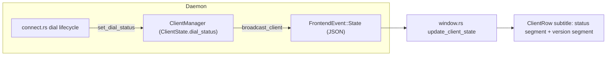

# Dial status in client rows + auto-open log on launch

## Part 1 — Dial status in the GUI row

Today the row subtitle only shows peer-version info (`ClientRow::refresh_version_status` in [client_row.rs](mousehop-gtk/src/client_row.rs)), so a failed dial is invisible. The daemon already knows the dial state (`connecting` map, retry gate, `active_addr`/`alive` in [connect.rs](mousehop/src/connect.rs)) but never tells the frontend.

### Data flow

### IPC — [mousehop-ipc/src/lib.rs](mousehop-ipc/src/lib.rs)

- New `DialStatus` enum next to `RemoteHostState` (~line 590): `Idle`, `Connecting`, `Connected`, `Unreachable`, `NoAddress`. Serde snake_case; `Default = Idle`.
- Add to `ClientState` (~line 585): `#[serde(default)] pub dial_status: DialStatus` — additive, older daemons deserialize as `Idle` (GUI then falls back to today's version-only subtitle).

### Daemon producer — [connect.rs](mousehop/src/connect.rs) + [client.rs](mousehop/src/client.rs) + [service.rs](mousehop/src/service.rs)

- `ClientManager::set_dial_status(handle, status)` mirroring `set_alive` (client.rs ~line 308).
- Transitions in `MousehopConnection` (it owns `client_manager`):
  - `Connecting` when a dial token is inserted — both in `send()` (~line 505) and `connect_handle()` (~line 538).
  - `Connected` on successful install in `connect_to_handle` (~line 787, next to `set_active_addr`).
  - `NoAddress` in the empty-candidate branch (~line 758); `Unreachable` when `connect_any` fails (~line 769) and in `disconnect()` (~line 1161).
- Broadcast: add `ClientManager::set_dial_status_changed(handle, status) -> bool` (compare-and-set). Service calls `broadcast_client(handle)` when it returns true:
  - in the `run()` select loop via a periodic ~1s tick (dialer tasks are `spawn_local`, same thread, so they can't call Service directly; the tick picks up compare-and-set changes without per-event churn),
  - immediately after `FrontendRequest::Connect` handling (service.rs ~line 416) so "connecting…" appears at once.
- `save_config` only persists `ConfigClient` fields — runtime `dial_status` is never written to config.toml (no change needed).

### GUI consumer — [client_object.rs](mousehop-gtk/src/client_object.rs), [client_row.rs](mousehop-gtk/src/client_row.rs), [window.rs](mousehop-gtk/src/window.rs)

- `ClientObject`: new `dial-status: u32` GObject property (index pattern like `crossing-modifier`); `ClientData.dial_status` seeded in `ClientObject::new`.
- `Window::update_client_state` (~line 520): write the property from `state.dial_status` before `row.refresh_version_status()`.
- `ClientRow::refresh_version_status` becomes a combined subtitle renderer:
  - status segment: `Connecting…` (grey italic), `Unreachable — retrying` (orange `#ffaa33`), `No address yet` (orange), `Connected` (green `#33cc66`), `Idle` → no segment;
  - append the existing version segment (`Peer version: …`) after ` · `;
  - when status is `Idle` (old daemon), render exactly today's version-only markup — no behavior change.
- Unit tests in mousehop-gtk: status→markup mapping incl. Idle fallback and Connected+matched-version combination.

## Part 2 — Open the current log on debug launch / Run Exe

Log paths already exist per role: `mousehop-daemon.log` / `mousehop-gui.log` under `%LOCALAPPDATA%\Mousehop\logs` (Windows), `~/Library/Logs/Mousehop` (macOS), `~/.local/state/mousehop` (Linux) — see [file_log.rs](mousehop/src/file_log.rs).

### New script `scripts/open-mousehop-log.ps1`

- Resolve `$env:LOCALAPPDATA\Mousehop\logs`; pick `mousehop-daemon.log` when present (dial/DNS detail lives there), else `mousehop-gui.log`; create empty if neither exists.
- Open in the editor: `code <path>` with fallback to `cursor <path>`; print the path so it is visible in the task terminal either way.

### Workspace wiring — [kvm-teleport.code-workspace](kvm-teleport.code-workspace)

- New task `Open Mousehop log`: Windows runs the script (powershell shell options like the build task); osx/linux inline `open`/`xdg-open` of the platform log dir; `presentation: { reveal: silent, focus: false }`.
- Debug config `Debug mousehop (Windows MSVC)` (~line 406): `preLaunchTask` becomes a compound task reference `{ "tasks": ["Build mousehop (debug)", "Open Mousehop log"] }` (add the compound entry under `tasks`). The editor tab opens before the process starts; the file re-reads as the daemon appends.
- `Launch mousehop (current platform)` task (~line 329, used by the Run Exe action button): append the log-open to each platform command after the launch (`; & scripts/open-mousehop-log.ps1` on Windows; `open`/`xdg-open` on osx/linux).

## Verify

- `cargo test -p mousehop-ipc -p mousehop -p mousehop-gtk`; `cargo fmt`; `cargo clippy` on touched crates (GTK env as in build script).
- Rebuild via `scripts/build-windows-release.ps1`; launch staged exe; point a client at an unreachable host → row shows `Connecting…` then `Unreachable — retrying`; reachable peer → `Connected · Peer version …`.
- Press Run Exe and F5 → log tab opens in the editor.
- README: one line in the Windows Logs section noting the row status subtitle and that Run Exe / F5 open the log.

## Out of scope

- Retry/backoff tuning, per-address status in the dropdown, incoming-peer status rows.