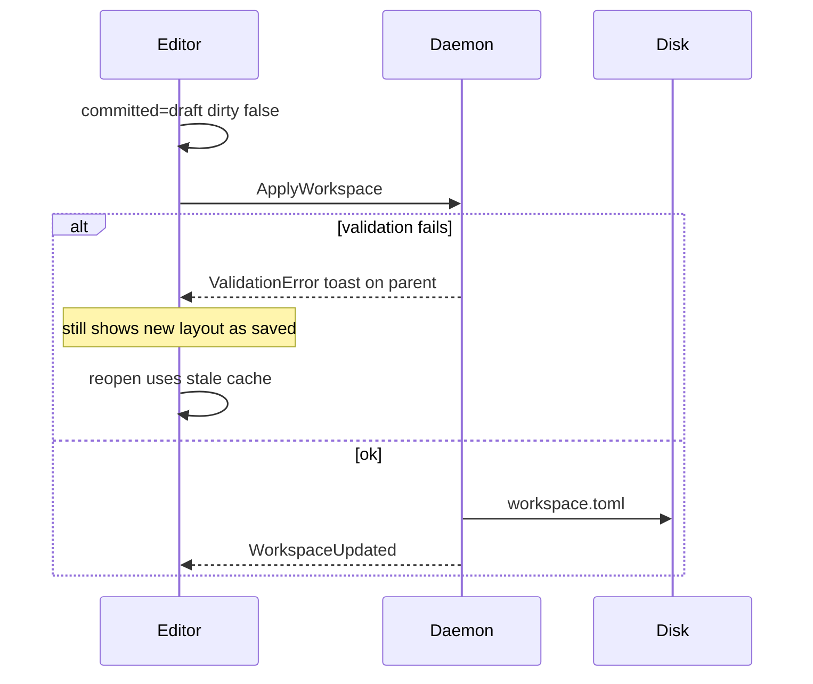

# Fix Shared Layout Apply (persist + feedback)

Refined with findings from [Trace ApplyWorkspace persist path](2205cdd0-aacf-4233-a49c-2c31c185fdc6).

## What’s going wrong

Evidence:

- `%LOCALAPPDATA%\mousehop\workspace.toml` exists (rev 6, remote at `3870,10`) — some applies *do* reach disk.
- Apply click in [`workspace_editor.rs`](mousehop-gtk/src/workspace_editor.rs) **optimistically** sets `committed = draft` *before* the daemon responds.
- Failures are `WorkspaceValidationError` toasts on the **parent** prefs window ([`lib.rs`](mousehop-gtk/src/lib.rs)); the modal layout dialog hides them.
- Editor looks “saved” even when the daemon rejected geometry — close/reopen uses stale cache → old placements.
- **Validation mismatch:** editor `validate_draft` uses `topologies_from_ipc(draft)` (placeholders when empty); [`apply_workspace_ipc`](mousehop/src/service.rs) ignores `ipc.devices` and [`apply_local`](mousehop/src/workspace_state.rs) uses live `self.topologies` only.
- **Reopen race:** Shared layout / About ([`window/imp.rs`](mousehop-gtk/src/window/imp.rs)) fires `GetWorkspace` then **immediately** `open_workspace_editor` from cache — often pre-apply / legacy draft until a later update.

## Fix (concrete)

### 1. Confirm-before-clean Apply — [`workspace_editor.rs`](mousehop-gtk/src/workspace_editor.rs)

- Add `pending_apply: bool` on `EditorState`.
- **Apply click:** validate locally; do **not** set `committed`; set `pending_apply`, clear error, banner `Applying…`, send `ApplyWorkspace`, `refresh_ui`.
- **`merge_incoming_workspace`:** if `pending_apply`, force `committed = draft = incoming`, clear flag, banner `Applied (revision N)` — before normal dirty/clean branches.
- Keep dirty/clean merge for topology/peer updates when not pending apply.

### 2. Route validation errors into the editor — [`window.rs`](mousehop-gtk/src/window.rs) / [`imp.rs`](mousehop-gtk/src/window/imp.rs) / [`lib.rs`](mousehop-gtk/src/lib.rs)

- Add `workspace_editor_error_hook` next to the live hook; register from `present_workspace_editor`; clear both on close.
- Hook clears `pending_apply`, sets `state.error`, `refresh_ui`.
- `WorkspaceValidationError`: call hook if set, else `show_toast`.

### 3. Defer Shared-layout open until fresh snapshot — [`window.rs`](mousehop-gtk/src/window.rs) / [`imp.rs`](mousehop-gtk/src/window/imp.rs)

- Same pattern as Setup Layout: set `pending_editor_open` (bool or optional selection), `request(GetWorkspace)`, open only from `set_workspace` when that flag is set (Shared layout button + About build row). Do not call `open_workspace_editor` synchronously after GetWorkspace.

### 4. Daemon: log + transactional apply + aligned topologies — [`service.rs`](mousehop/src/service.rs) / [`workspace_state.rs`](mousehop/src/workspace_state.rs)

- `log::info!` on apply success (id, revision, placement count); `log::warn!` on failure.
- `apply_local`: assign `self.config` only after routes/snapshot succeed, then `save_to_disk`.
- Before `apply_local`, build a topology map: for each placed fingerprint prefer `workspace.topologies()`, else parse from `ipc.devices` (reuse/adapt GTK `topologies_from_ipc` logic into a shared helper used by `apply_workspace_ipc` pre-check / `derive_routes`). Reject with the same geometry errors the editor would show when devices carry real sizes.

### 5. Tests + verify

- Unit: pending-apply merge clears flag; error path clears pending and leaves committed unchanged.
- `cargo test -p mousehop-gtk -p mousehop`, fmt/clippy.
- Manual: Apply → revision/Applied + `workspace.toml` matches; reopen Shared layout keeps origins; overlap → editor error banner; reopen keeps last good layout.

## Out of scope

- Changing snap/route geometry rules; follower edit; hard-coding `is_authority` cleanup on the no-config draft path (optional later).
