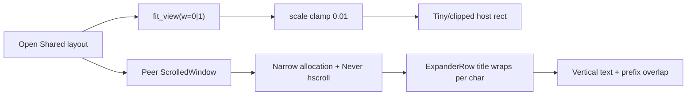

# Fix Shared layout arranger panel UI

## Diagnosis

The panel is the GTK/libadwaita dialog in [`mousehop-gtk/src/workspace_editor.rs`](mousehop-gtk/src/workspace_editor.rs) (`present_workspace_editor`), not an unfinished stub. The “mess” matches two concrete layout bugs:

1. **Crushed peer sidebar (vertical fingerprint text + overlapping checkbox)**  
   The left column only sets `min_content_width(220)` and never pins width / disables hexpand, while the canvas column hexpands. Horizontal scroll is `Never`, so a narrow allocation forces `adw::ExpanderRow` titles (often a fingerprint) to wrap one character per line. A `CheckButton` via `add_prefix` shares the ExpanderRow leading slot with the disclosure control, which matches the overlapping purple check + chevron.

```127:128:mousehop-gtk/src/workspace_editor.rs
    peer_scroller.set_min_content_width(220);
    peer_scroller.set_vexpand(true);
```

```513:526:mousehop-gtk/src/workspace_editor.rs
            let select = gtk::CheckButton::new();
            select.set_active(selected);
            select.set_tooltip_text(Some("Select host"));
            select.connect_toggled(glib::clone!(
                #[strong]
                state,
                #[strong]
                fp,
                move |btn| {
                    if btn.is_active() {
                        state.borrow_mut().selected = Some(fp.clone());
                    }
                }
            ));
            row.add_prefix(&select);
```

2. **Bad initial canvas scale**  
   On open, `fit_view` uses `area.width()/height()` before the DrawingArea is realized (often `0` → forced to `1`). With `pad = 48`, scale clamps to `0.01`, so a 1920×1080 host draws ~19×11 px with clipped `show_text`. Default scale `0.08` is overwritten and never re-fit on first real allocate (only manual Fit / zoom).

```249:251:kvm-teleport/mousehop-gtk/src/workspace_editor.rs
    refresh_ui();
    fit_view(&state, area.width().max(1), area.height().max(1));
    area.queue_draw();
```



Out of scope for this fix (follow-ups): live `WorkspaceUpdated` into an already-open editor; Claim authority not refreshing the dialog; validation errors toasting on the main window only.

## Implementation (all in `workspace_editor.rs`)

### 1. Pin the peer sidebar

- `peer_scroller.set_hexpand(false)`
- `peer_scroller.set_size_request(280, -1)` (hard floor; keep `min_content_width` at ≥280)
- Keep `PolicyType::Never` for horizontal scroll once width is guaranteed

### 2. Stop packing CheckButton into ExpanderRow prefix

- Remove the prefix `CheckButton`
- Select a host by activating the ExpanderRow (or a `GestureClick` on the row): set `state.selected`, then call `refresh_ui()`
- Keep existing `accent` / subtitle “· selected” as the selection affordance; canvas click selection already exists and stays
- This removes the overlapping check/chevron and frees title width

### 3. Defer / re-run `fit_view` when the canvas has a real size

- Remove the premature construct-time `fit_view(..., area.width().max(1), ...)`
- Track `needs_fit: bool` (or equivalent) in `EditorState`; set true on open and when Fit is pressed
- On `DrawingArea` resize (or at the start of `draw_func` when `needs_fit` and `width/height` are large enough, e.g. both `> 64`), call `fit_view` once and clear the flag
- In `fit_view`, if width/height are below a small threshold, no-op instead of clamping to `0.01`
- Keep Fit button and zoom handlers calling the same path with the current allocated size

### 4. Light canvas label hygiene

- Skip host labels when the drawn rect height is too small for the fixed `(+6, +16)` baseline, so a bad scale cannot spew clipped glyphs over the grid

## Verification

- `cargo build -p mousehop-gtk`
- Manual: Outgoing Connections → **Shared layout…**
  - Peer list readable at ~280px; fingerprint/title on one line (or ellipsized), no vertical wrap
  - No overlapping check + chevron
  - On open, host group(s) fill a sensible portion of the grid without clicking Fit
  - Click peer row selects; canvas drag / Snap / Apply still work for authority
