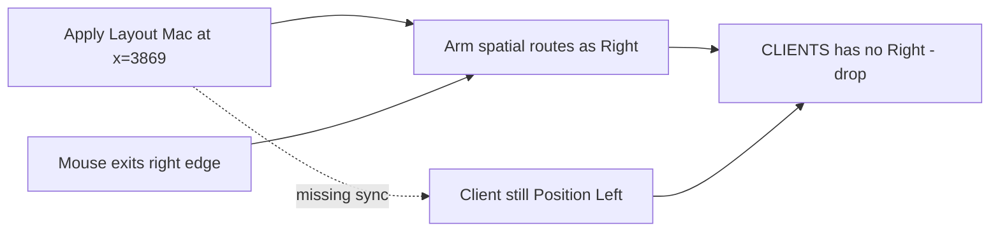

# Fix Layout edge-cross + Mac workspace sync

## Confirmed root cause (your machine)

From [config.toml](C:\Users\pho\AppData\Local\mousehop\config.toml) + [workspace.toml](C:\Users\pho\AppData\Local\mousehop\workspace.toml) + logs:

- Client `m1mbp.local` has **`position = "left"`** and Activate logged **`activated client 0 (left)`**
- Canvas places Apogee at `(0,0)` and the Mac fingerprint at **`(3869, 197)`** → Mac is to the **right**
- After shared Layout landed, Windows capture prefers **armed spatial routes** (mapped from workspace edges → `Position::Right`), then requires a client registered at that Position. Mismatch → **silent no-op** (no Begin / Enter)

Old `Placement: Right` worked because GUI Position matched the physical edge. Shared Layout removed that control but left capture keyed on Position.

Mac Layout not updating is a separate publish/ingest gap (silent skips / authority reject), not a connection failure.

## Fix 1 — Sync Position from workspace on Apply (primary)

In [`mousehop/src/service.rs`](mousehop/src/service.rs) after a successful `apply_workspace_ipc` (and after successful `ingest_workspace_chunk` on followers that also capture):

1. From the routing snapshot, for each outgoing client with a known peer fingerprint, derive the cardinal `Position` from routes where `src_peer == local` and `dst_peer == that client` (map `DisplayEdge` → `Position` the same way as `armed_routes_from_snapshot` in [`mousehop/src/capture.rs`](mousehop/src/capture.rs)).
2. If multiple edges exist to one peer, pick the longest interval (deterministic).
3. Call existing `update_pos(handle, pos)` so capture is recreated on the correct barrier, then `save_config()` so `config.toml` stops saying `left`.

This restores the invariant: **canvas adjacency ↔ capture Position ↔ armed route Position**.

## Fix 2 — Arm spatial routes when capture starts

Today `SetSpatialRouting` only arms while a capture session is live ([`capture.rs` idle path stores snapshot without arming](mousehop/src/capture.rs); `create_captures` never arms).

- At the start of `do_capture_session` (right after `create_captures`), call `arm_spatial_routes`.
- Keep re-arming on later `SetSpatialRouting`.

## Fix 3 — Make Mac Layout sync reliable + visible

In [`publish_workspace_to_peers`](mousehop/src/service.rs) / ingest:

- Log at **info**: chunk count, target handles (or "0 targets" with reason: no addr / no CAP / not authority).
- Log at **info** on successful ingest (`revision`, publisher).
- On Unauthorized ingest (Mac already self-authority), warn with a clear message that the follower must clear local authority / accept the publisher — or, when follower has no live placements / was never connected as authority peer, accept first remote publish from an authenticated DTLS peer (concrete choice: **if local `authority_fingerprint == self` and revision is only from a prior local Apply with no outbound clients, allow overwrite from authenticated publisher**; otherwise keep Unauthorized and surface UI toast).

Also ensure Apogee’s topology reaches the Mac: dialer currently receives topology but does not push local `IdentifiedTopology` outbound — add a one-shot / periodic send on the outbound DTLS path when `CAP_SHARED_WORKSPACE` is negotiated so the Mac can derive reverse routes (needed for return-crossing and a complete Layout view).

## Fix 4 — Observability for silent barrier drops

In [`input-capture/src/windows/event_thread.rs`](input-capture/src/windows/event_thread.rs), when an armed/legacy barrier Position is hit but `CLIENTS` lacks that Position, log a **warn** once (rate-limited) instead of returning silently. Makes future mismatches obvious.

## Verification

1. Apply Layout with Mac to the right of Apogee → `config.toml` `position` becomes `"right"`; log shows `activated client 0 (right)` (or deactivate/reactivate cycle).
2. Move mouse off Apogee’s right edge → Begin/Enter and control on Mac.
3. On Mac: after Apply on Apogee, Layout revision matches; log shows workspace chunk publish + ingest.
4. Move mouse back from Mac → return route works (after topology push).
5. `cargo test -p input-event -- workspace` and any new unit test for "derive Position from snapshot for peer".

## Out of scope

- HopDeck TCP/TLS transport branch
- Reintroducing the old Position combo in the GTK row UI (daemon sync replaces it)
