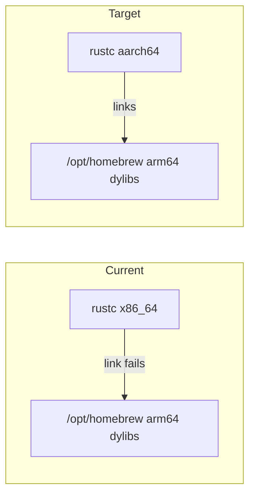

# Fix macOS build: aarch64 Rust + arm64 Homebrew

## Diagnosis

The linker errors are an architecture mismatch, not a missing script step:

- Host CPU: `arm64`; Homebrew: `/opt/homebrew` (arm64)
- Active Rust: `1.95.0-x86_64-apple-darwin` (and PATH also exposes `/usr/local/bin/rustc` 1.98.1 x86_64)
- rustup reports: *“not running natively… under emulation of x86_64-apple-darwin”* with `Default host: x86_64-apple-darwin`
- So cargo builds for x86_64 and ignores `/opt/homebrew` dylibs → undefined `git_*` / glib symbols

This is exactly what [README.md](README.md) already calls out under **Development → MacOS**:

> Match the Rust host to your Homebrew prefix. On Apple Silicon use `/opt/homebrew` with an `aarch64-apple-darwin` toolchain…

`1.95.0-aarch64-apple-darwin` is already installed; it is just not the active host for this repo’s `rust-toolchain.toml` pin (`channel = "1.95.0"` → resolves via default host).



## Plan (environment + rebuild; no code changes)

### 1. Make rustup native aarch64 for this machine

In a **native** (non-Rosetta) arm64 shell:

```sh
rustup set default-host aarch64-apple-darwin
# confirm this repo picks the right pin:
cd /Users/pho/repo/External/kvm-teleport
rustup show   # active should be 1.95.0-aarch64-apple-darwin
rustc -vV     # host: aarch64-apple-darwin
```

If rustup itself remains an x86_64 binary, reinstall the official aarch64 rustup (rustup’s own warning) so `~/.cargo/bin` shims are native; keep using [rust-toolchain.toml](rust-toolchain.toml)’s `1.95.0` pin.

Also put `~/.cargo/bin` **before** `/usr/local/bin` on `PATH` so Homebrew’s Intel `rustc`/`cargo` cannot hijack the build.

### 2. Rebuild per README

```sh
scripts/makeicns.sh
(cd mousehop && cargo bundle --release)
scripts/copy-macos-dylib.sh target/release/bundle/osx/Mousehop.app/Contents/MacOS/mousehop
```

Run from repo root; `cargo bundle` must stay inside `mousehop/` so icon/plist globs resolve. Do not run `copy-macos-dylib.sh` until the MacOS binary exists.

### 3. Verify

- `file target/release/bundle/osx/Mousehop.app/Contents/MacOS/mousehop` → `arm64`
- `scripts/copy-macos-dylib.sh` completes (`Done!`) including the bundled `--version` check
- App path: `target/release/bundle/osx/Mousehop.app`

No README or script edits unless the rebuild still fails after the host is aarch64.