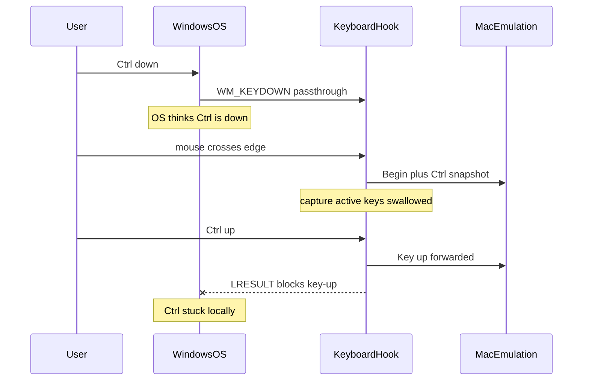

# Fix stuck Ctrl with Require Modifier to Cross

## Diagnosis

Your setup (Windows host to MacBookPro.lan, Require Modifier to Cross + Control) makes this fire on every successful cross.

**Local stuck Ctrl (primary):** Before capture, Ctrl-down is delivered to Windows via `CallNextHookEx`. After edge activation in [input-capture/src/windows/event_thread.rs](input-capture/src/windows/event_thread.rs), `kybrd_proc` forwards keys to the peer and returns `LRESULT(1)`, so the matching Ctrl-up never reaches the OS. Require-modifier forces Ctrl held at every cross, so local apps keep seeing Ctrl down even after you return.

**Remote stuck Ctrl (secondary):** On Enter, Windows emits a held-modifier snapshot (Key-downs + aggregate Modifiers with Control) to the Mac peer. Two gaps can leave Control asserted while you are controlling the Mac:

1. In [mousehop/src/capture.rs](mousehop/src/capture.rs), `pending_cross` discards intermediate snapshot Key events while waiting (`return Ok(())` without buffering). Accepting later on the aggregate Modifiers event can apply Control on macOS via `set_modifiers` without a wire-visible Key-down in `pressed_keys`.
2. In [input-emulation/src/lib.rs](input-emulation/src/lib.rs), unmatched key-ups are dropped (`pressed_keys.remove` returns false and skips `consume`), so a later Ctrl-up never clears macOS `modifier_state`.

## Fix

### 1. Windows host: steal / restore modifiers around capture

In [input-capture/src/windows/event_thread.rs](input-capture/src/windows/event_thread.rs):

- On capture activation (right after `ACTIVE_CLIENT` is set): `SendInput` KEYUP for every key in `HOST_MODIFIERS`, tagged with a private `dwExtraInfo`.
- Track physical state in `HOST_MODIFIERS` from real (non-injected) hook events only.
- On `RequestType::Release`: for keys still in `HOST_MODIFIERS`, `SendInput` KEYDOWN to restore local OS state; skip keys already released on the peer.
- In `kybrd_proc`: ignore `LLKHF_INJECTED` / our `dwExtraInfo` for forwarding and for `HOST_MODIFIERS` updates.

This is the Synergy/Deskflow pattern: local apps see modifiers released while the peer owns the cursor; physically still-held keys are restored on return.

### 2. Buffer `pending_cross` snapshot events

In [mousehop/src/capture.rs](mousehop/src/capture.rs), extend `PendingCross` with a short buffer. On `WaitForSnapshot`, push the event instead of dropping it. On `Accept`, replay Begin, then buffered events, then the accepting event. On `Reject`, discard the buffer and `release()` as today.

### 3. Always consume key-ups in emulation

In [input-emulation/src/lib.rs](input-emulation/src/lib.rs), change `update_pressed_keys` so releases always return true (idempotent up), while presses still dedupe. A Modifiers-only Control snapshot can then still be cleared by a physical Ctrl-up on macOS.

### 4. Tests and docs

- Unit: `pending_cross` replays buffered Key downs when Accept fires on aggregate Modifiers; Reject still drops them.
- Unit: emulation processes a key-up when the key was not in `pressed_keys`.
- Logic tests for steal/restore set membership (KEYUP on enter / KEYDOWN on leave).
- Short README note under Require a modifier to cross: held gate modifiers are released locally during capture and restored on return if still physically held.

## Out of scope

Same host steal/restore on macOS / layer-shell capture hosts. Repro is Windows to Mac; fix that path first.
