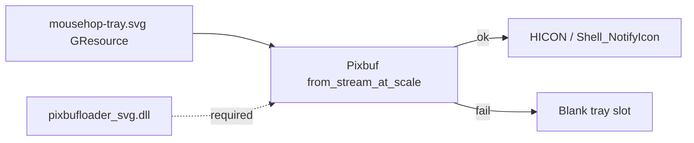

# Fix Windows blank system-tray icon

## Root cause

[`windows_tray.rs`](mousehop-gtk/src/windows_tray.rs) rasterizes [`mousehop-tray.svg`](mousehop-gtk/resources/icons/mousehop-tray.svg) through gdk-pixbuf into an `HICON`. On failure it still registers a clickable tray slot **without** `NIF_ICON` — a clear box:

```414:421:mousehop-gtk/src/windows_tray.rs
    // A failed glyph render leaves a null HICON; claiming NIF_ICON
    // with a null handle risks the whole NIM_ADD being rejected,
    // while adding without it still claims a (blank) clickable slot —
    // which beats having no way back to a hidden window.
    if !icon.is_invalid() {
        data.uFlags |= NIF_ICON;
        data.hIcon = icon;
    }
```

Your local GTK stack **does** have the SVG loader at `C:\gtk-build\gtk\x64\release\lib\gdk-pixbuf-2.0\2.10.0\loaders\pixbufloader_svg.dll`, and it is the **only** external pixbuf module (PNG is built-in).

[`scripts/build-windows-release.ps1`](scripts/build-windows-release.ps1) and [`.github/workflows/release.yml`](.github/workflows/release.yml) only copy `bin\*.dll` into `mousehop-windows\`. That includes `rsvg-2-2.dll` and `gdk_pixbuf-2.0-0.dll`, but **not** `pixbufloader_svg.dll` or `loaders.cache`.

Windows DLL search loads those DLLs from the exe directory first, which **shadows** the working GTK install on `PATH`. Result: staged/`mousehop-windows` runs cannot decode SVG → blank tray. Running `target\release\mousehop.exe` with GTK on `PATH` (no side-by-side DLLs) still finds the loader and can look fine — which matches “used to work.”



## Approach

Ship the SVG loader with the Windows package, point gdk-pixbuf at it before GTK starts (same idea as macOS `configure_macos_bundle_environment`), and keep a built-in PNG fallback so a missing loader cannot blank the tray again.

### 1. Package gdk-pixbuf SVG loader

Update [`scripts/build-windows-release.ps1`](scripts/build-windows-release.ps1) and the Windows archive step in [`.github/workflows/release.yml`](.github/workflows/release.yml):

- After copying `bin\*.dll`, also stage:
  - `lib\gdk-pixbuf-2.0\2.10.0\loaders\pixbufloader_svg.dll`
  - `lib\gdk-pixbuf-2.0\2.10.0\loaders.cache`
- Fail the script with a clear error if `librsvg` / the SVG loader is missing (README already says release packaging needs `librsvg`).
- Fix the stray `S#` at line 1 of the build script (PowerShell tries to invoke `mousehop.exe` from that broken comment every run).

### 2. Set `GDK_PIXBUF_MODULE_FILE` on Windows startup

In [`mousehop-gtk/src/lib.rs`](mousehop-gtk/src/lib.rs), add a Windows counterpart to `configure_macos_bundle_environment()`, called at the start of `gtk_main()` **before** any pixbuf/GTK use:

- Resolve `current_exe()` dir.
- If `<exe_dir>\lib\gdk-pixbuf-2.0\2.10.0\loaders.cache` exists, set `GDK_PIXBUF_MODULE_FILE` to that absolute path.
- Keep the existing relative loader paths from gvsbuild’s cache (`lib\gdk-pixbuf-2.0\...`); gdk-pixbuf resolves them against the GTK prefix. If relative resolution is unreliable next to a flat DLL layout, regenerate the staged `loaders.cache` during packaging with **absolute** paths under the stage dir (or rewrite paths at startup to absolute paths under `exe_dir`). Prefer packaging-time absolute paths in the staged cache so runtime stays simple.

### 3. PNG fallback in `windows_tray` (hardening)

gdk-pixbuf here has no external PNG module (PNG is built-in), so a resource PNG still loads when SVG cannot.

- Add two small committed assets (e.g. 64×64) under `mousehop-gtk/resources/icons/`:
  - black glyph for light taskbar
  - white glyph for dark taskbar  
  Generated once from `mousehop-tray.svg` via `rsvg-convert` (already on the GTK stack).
- Register them in [`resources.gresource.xml`](mousehop-gtk/resources/resources.gresource.xml).
- In `render_icon` / `render_svg`: if SVG rasterize fails, load the matching PNG with `Pixbuf::from_resource_at_scale` and continue to `icon_from_pixbuf`. Log the fallback at `warn` so missing loaders stay visible in logs.

### 4. Docs

Short note in [`README.md`](README.md) Windows packaging section: the zip must include the gdk-pixbuf SVG loader tree (or rely on the PNG fallback), and `librsvg` remains required for the preferred SVG path / matching release deps.

## Verification

- Rebuild with `scripts/build-windows-release.ps1`.
- Run **from** `target\release\mousehop-windows\mousehop.exe` (not `target\release` with PATH GTK).
- Confirm a visible tray glyph (light and dark taskbar if easy to toggle).
- Optional: temporarily rename the staged `loaders` dir and confirm PNG fallback still shows an icon; restore afterward.
- With `RUST_LOG=mousehop=debug`, confirm either successful SVG render or a single fallback warning — not a silent blank slot.
