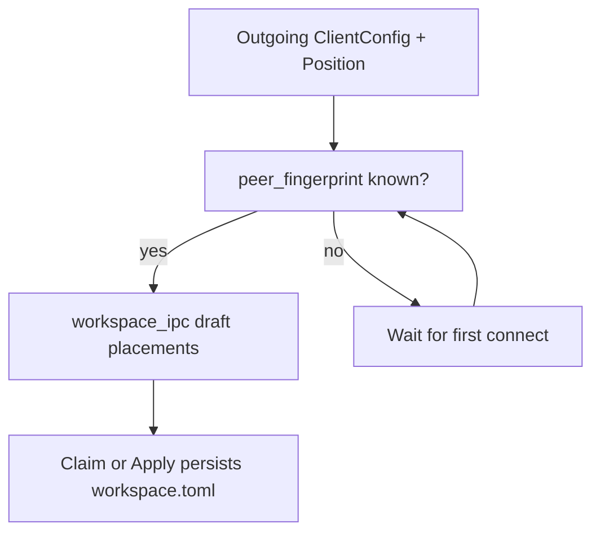

# Convert legacy clients into shared workspace

## Decision locked

**Known fingerprints only.** Outgoing clients without a TLS fingerprint stay off the arranger until first successful connect; then they are drafted/seeded automatically. No hostname-keyed temporary placement keys.

## Current gaps

- [`workspace_device_ipc`](mousehop/src/service.rs) labels from `authorized_keys.description` or `fingerprint.chars().take(8)` — never `ClientConfig.hostname` / local hostname.
- No-`workspace.toml` path and [`ensure_authority_workspace`](mousehop/src/workspace_state.rs) only seed **local**.
- Draft extras only iterate `workspace.topologies()` — a connected peer with known fp but no `IdentifiedTopology` yet still never appears.

## Implementation

### 1. Hostname-first labels — [`mousehop/src/service.rs`](mousehop/src/service.rs)

Change `workspace_device_ipc` label resolution to:

1. **Local** (`fingerprint == public_key_fingerprint`): OS hostname (`hostname::get`, same idea as discovery’s `local_hostname`)
2. **Outgoing match**: any client whose `state.peer_fingerprint` / `outgoing_peer_fps` equals this fp → `config.hostname` if set
3. Else non-empty `authorized_keys[fp].description`
4. Else `authorized_keys[fp].last_hostname`
5. Else fingerprint prefix (unchanged fallback)

### 2. Seed placements from legacy clients — service + workspace_state

Add a helper on `Server` (e.g. `legacy_workspace_placements()`) that returns `Vec<DevicePlacement>` / IPC placements:

- Always include **local** at `(0, 0)` when local topology exists (same as today).
- For each outgoing client with a known fingerprint (`outgoing_peer_fps` or `ClientState.peer_fingerprint`):
  - Skip duplicates.
  - Compute origin from that client’s legacy [`Position`](mousehop-ipc/src/lib.rs) relative to the **local topology AABB** (or placeholder 1920×1080 if no local displays yet):
    - `Right` → `(local_max_x, local_min_y)`
    - `Left` → `(local_min_x - peer_w, local_min_y)` where `peer_w` is peer topology width or 1920
    - `Bottom` / `Top` analogously on Y
  - Multiple peers on the same edge: stack with a fixed gap (e.g. +1200 on the free axis) so origins do not coincide.

Wire it in three places:

| Call site | Behavior |
|-----------|----------|
| `workspace_ipc()` when `config` is `None` | Draft = legacy seed (local + known-fp clients), not local-only |
| `workspace_ipc()` when config exists | Keep existing placements; also draft-add any known-fp outgoing (and topology keys) **not** already placed — same as today’s topology loop, extended to fingerprints |
| `ensure_authority_workspace` / Claim | Persist seed placements (local + known-fp clients with Position origins), not local-only |

Refactor [`ensure_authority_workspace`](mousehop/src/workspace_state.rs) to accept an initial `placements: Vec<DevicePlacement>` (or have `Server::set_workspace_authority` build `WorkspaceConfig` and `apply_local` directly) so Claim creates a real multi-host workspace.

### 3. Appear after first connect

In [`note_outgoing_peer_fingerprint`](mousehop/src/service.rs), after recording the fp, emit `FrontendEvent::WorkspaceUpdated(self.workspace_ipc())` so the GUI/arranger can pick up the new draft peer without restart.

Devices without topology keep empty `displays` → existing editor placeholder rects (`PLACEHOLDER_W/H` in [`workspace_editor.rs`](mousehop-gtk/src/workspace_editor.rs)).

### 4. Arranger sees fresh data

- Keep opening via GetWorkspace, but ensure the main window’s `set_workspace` path is what the editor reads on open (already); after fingerprint/topology updates, `WorkspaceUpdated` must refresh an **already open** editor.
- Minimal approach: store a weak/callback or `Rc<RefCell<Option<…>>>` refresh hook from `present_workspace_editor`, registered on the `Window` while the dialog is open; `WorkspaceUpdated` in [`mousehop-gtk/src/lib.rs`](mousehop-gtk/src/lib.rs) updates cache **and** pushes into the open editor (replace committed+draft when not dirty, or only merge new device/placement rows when draft == committed).
- Concrete merge rule: if `draft == committed`, replace both with the new IPC and `needs_fit = true`; if the user has unsaved moves, merge in **new** fingerprints only (append placements/devices) without moving existing draft origins.

### 5. Docs / tests

- Update [`SHARED_LAYOUT.md`](SHARED_LAYOUT.md): first Claim/Apply seeds known-fp outgoing clients from legacy Position; labels use hostnames; peers appear after first connect.
- Unit-test the Position→origin helper (Right/Left/Top/Bottom + two peers on same edge).
- Unit-test label priority (local hostname, outgoing hostname, description, fingerprint).

## Out of scope

- Persisting placements for clients with no fingerprint yet
- Auto-disabling legacy Position before Apply (existing “managed by shared workspace” gate stays as-is once placed)
- Forcing Mac to send `IdentifiedTopology` (still required for real monitor sizes; placeholders until then)
