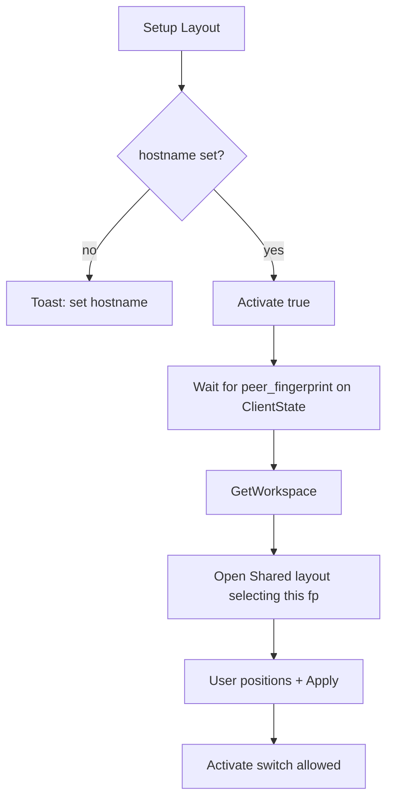

# Setup Layout replaces outgoing Position UI

## Goal

- No more user-facing **Position** (Left/Right/Top/Bottom) on outgoing client rows.
- Per-row **Setup Layout** connects the peer, waits for TLS fingerprint (+ topology when available), then opens Shared layout with that peer selected for positioning.
- Header **Shared layout…** only edits an **existing applied** workspace (not first-time setup).

## Runtime constraint (locked default)

`Activate` still creates Position-keyed capture barriers ([`service.rs` `activate_client`](mousehop/src/service.rs)). Keep `ClientConfig.pos` as a silent default (`Left`) for IPC/migration/seed helpers, but:

- **Block enabling capture** (Activate switch → toast) until the peer’s fingerprint is present in workspace placements (after Apply), **or** until Setup Layout has opened and the user Applied.
- After Apply, existing spatial routing + “managed by workspace” behavior continues; silent `pos` remains only for barrier create when needed.

## UI changes

### 1. Client row — [`mousehop-gtk/resources/client_row.ui`](mousehop-gtk/resources/client_row.ui) + [`client_row/imp.rs`](mousehop-gtk/src/client_row/imp.rs)

- Remove (or hide permanently) the Position `AdwComboRow`.
- Add an `AdwActionRow` / button row **Setup Layout** with subtitle like “Connect this peer and place it in the shared workspace.”
- Emit a new signal `request-setup-layout` (no args) from the row.
- Drop Position change signal wiring / `set_position_managed` UI (or no-op stubs if bindings still reference `position` briefly while cleaning property binds in [`client_row.rs`](mousehop-gtk/src/client_row.rs)).

### 2. Header — [`window.ui`](mousehop-gtk/resources/window.ui) + [`window/imp.rs`](mousehop-gtk/src/window/imp.rs)

- Keep **Shared layout…** label; set `sensitive` only when workspace is **applied**:
  - `!workspace.workspace_id.is_empty() && workspace.revision > 0`
  - Update sensitivity in `set_workspace` / after Apply events.
- About → build row: same gate (edit only), or open Setup Layout only if a selected client exists — **use the same gate** (edit-only).

### 3. Setup Layout orchestration — [`window.rs`](mousehop-gtk/src/window.rs)

On `request-setup-layout` for a `ClientRow`:

Concrete steps:

1. If hostname empty → toast and return.
2. `FrontendRequest::Activate(handle, true)` to initiate connect.
3. Track pending setup handle on `Window` (`Cell`/`RefCell<Option<ClientHandle>>`).
4. When `update_client_state` sees that handle with `peer_fingerprint: Some(fp)`:
   - Clear pending (or keep until editor opens).
   - `GetWorkspace` then `open_workspace_editor` with **initial selected = fp** (extend [`present_workspace_editor`](mousehop-gtk/src/workspace_editor.rs) / `EditorState.selected`).
5. Timeout (~15–30s) without fingerprint → toast (“Could not connect / identify peer”) and clear pending.
6. Prefer waiting one `WorkspaceUpdated` after `GetWorkspace` before open when possible (avoid empty-cache race); reuse existing live editor hook for late topology.

### 4. Activate gating — [`window.rs`](mousehop-gtk/src/window.rs) + row switch

- On `request-activate(true)`: if peer fingerprint missing **or** not in `workspace.placements` → show toast (“Use Setup Layout to place this peer first”), do not send Activate(true) (or immediately deactivate).
- Activate(false) always allowed.
- After Apply places the peer, switch works as today.

### 5. Daemon / IPC

- **No new IPC required** for the minimal path (reuse Activate, GetWorkspace, ApplyWorkspace).
- Keep `UpdatePosition` for backward compat with old configs; GTK stops sending it.
- Legacy seed in [`workspace_legacy.rs`](mousehop/src/workspace_legacy.rs) still uses stored `pos` when fingerprint known (default Left → place left of local unless user moves in arranger). New peers from Setup Layout appear via known-fp draft seed; user repositions in the editor before Apply.

### 6. Docs

Update [`SHARED_LAYOUT.md`](SHARED_LAYOUT.md) and any Position subtitle copy: first-time via **Setup Layout** on the client row; **Shared layout…** edits applied workspaces only; Position combo removed from GUI.

## Files to touch

- [`mousehop-gtk/resources/client_row.ui`](mousehop-gtk/resources/client_row.ui)
- [`mousehop-gtk/src/client_row.rs`](mousehop-gtk/src/client_row.rs), [`client_row/imp.rs`](mousehop-gtk/src/client_row/imp.rs)
- [`mousehop-gtk/src/window.rs`](mousehop-gtk/src/window.rs), [`window/imp.rs`](mousehop-gtk/src/window/imp.rs)
- [`mousehop-gtk/resources/window.ui`](mousehop-gtk/resources/window.ui) (sensitivity only if needed)
- [`mousehop-gtk/src/workspace_editor.rs`](mousehop-gtk/src/workspace_editor.rs) (select fingerprint on open)
- [`SHARED_LAYOUT.md`](SHARED_LAYOUT.md)

## Out of scope

- Removing Position from capture/protocol entirely
- Auto-Apply without user confirmation in the arranger
- Changing Linux barrier backends
