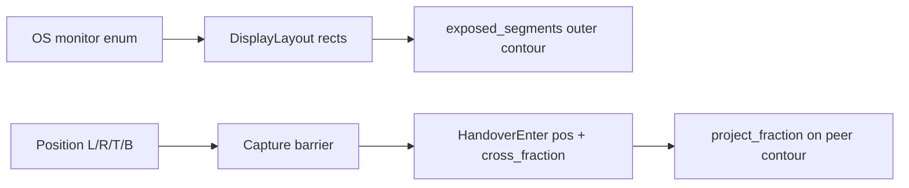

# Shared Spatial Monitor Layout

## Current state (verified)



- Geometry in [`input-event/src/display.rs`](input-event/src/display.rs): half-open `DisplayRect`, `DisplayLayout`, `exposed_segments()` = **per-cardinal outer envelope only** (stepped shell; **not** inward/gap-facing edges). Confirmed by docs and tests (e.g. LINUX_RECTS top contour omits lower-monitor tops facing the void).
- Topology wire: [`ProtoEvent::DisplayLayout`](mousehop-proto/src/lib.rs) v1 = anonymous `(x,y,w,h)` + `epoch`/`generation`; no stable display IDs.
- Landing: `HandoverEnter { serial, pos, cross_fraction }` → union-normalized fraction → `project_fraction`. **Not** per-display absolute landing.
- Ownership: transactional serial + `CAP_ATOMIC_HANDOVER` / `CAP_TRANSACTIONAL_HANDOVER` already solid; reuse.
- Config/UI: one `Position` per outgoing client ([`config.rs`](mousehop/src/config.rs), GTK `AdwComboRow`); no shared workspace.
- Transport: DTLS/UDP only (DOC.md TCP request note is stale). No reliable control channel for large blobs.
- Capture: macOS uses contour; Windows uses leave-union cardinal sides. Both are **outer-perimeter**, keyed by `Position`, not by adjacency intervals. Multi-peer same edge = FIFO queue, not spatial split.

## Architectural decisions (locked)

1. **Keep** `exposed_segments` for existing Linux barrier backends; **add** a separate routing layer for full per-rect boundary segments (including inward-facing edges not covered by a same-device neighbor).
2. **Workspace unit** = logical points as reported by each platform’s capture/warp APIs (macOS Quartz points; Windows virtual-screen pixels). Document mixed-DPI: fractions map in logical space; physical mm calibration out of scope.
3. **Authority** = one TLS fingerprint in config (`workspace.authority_fingerprint`); only that peer’s publishes are accepted. No CRDT/election.
4. **Sync** = new DTLS ProtoEvents with bounded size + ACK/retry (handover-style), not a new TCP stack. Snapshot budget: hard max (~48 KiB / fixed chunk count) with validation reject if exceeded.
5. **Hot path** = immutable `RoutingSnapshot` rebuilt only on topology/layout change; mouse events do interval lookup only.
6. **Legacy** = if either peer lacks `CAP_SHARED_WORKSPACE`, keep today’s `Position` + `cross_fraction` path unchanged.
7. **Inward edges**: implement geometry + Win/macOS segment-crossing detection against the active routing snapshot. Document residual OS limitation: where the OS clips the pointer so it never leaves a void-facing edge, that transition cannot fire (explicit limitation, not silent geometry-only claim).

## Vertical slice scope

Must work end-to-end with tests:

- Per-display topology exchange with stable IDs + generation.
- Authority publishes workspace placements; followers validate, cache, persist.
- Partial-edge bidirectional routing and exact landing (display id + local coords).
- Third peer routable without a single global offset.
- Existing transactional ownership, emergency release, and disconnect cleanup preserved.
- Minimal GTK editor: device-group drag, snap, overlap errors, authority/follower badge.
- Linux/other platforms: compile; legacy Position behavior unchanged unless they negotiate the new cap (routing integration focused on Win/macOS backends first).

Out of slice (call out at completion): per-monitor drag within a device, physical calibration, polished editor, full Linux barrier segment arming, property-based tests (no proptest in repo).

## Implementation plan

### 1. Geometry / routing (`input-event`)

Add [`input-event/src/workspace.rs`](input-event/src/workspace.rs) (or `routing.rs`) beside `display.rs`:

- `LocalDisplay { id: DisplayId, rect: DisplayRect, scale: Option<f32>, rotation: Option<u16> }`
- `LocalTopology { displays, epoch, generation }` — IDs are opaque strings (OS-provided or documented fallback: content hash of rect+adapter name, **never** enum order alone).
- `DevicePlacement { peer_fingerprint, origin_in_workspace: (i32,i32) }` — places the device’s local origin; monitors keep relative OS arrangement.
- `WorkspaceConfig { workspace_id, revision, authority_fingerprint, placements }`
- `boundary_segments(topology)` → all half-open edge intervals of each display **not shared with another same-device display** (includes inward U edges).
- `derive_routes(workspace, topologies) -> Result<RoutingSnapshot, WorkspaceError>`:
  - Transform each display into workspace coords.
  - Reject overlapping displays from different devices (error; do not pick a peer).
  - Same-device overlaps ignored for routing (OS owns internals).
  - Adjacent opposite edges with overlapping cross-intervals → `RouteInterval { src_peer, src_display, src_edge, range, dst_peer, dst_display, dst_edge, dst_range }`.
  - Multiple disjoint intervals per source edge allowed.
  - Gaps / non-overlap → walls.
- `RoutingSnapshot::lookup(src_peer, point, outbound_dir) -> Option<Landing>` with deterministic corner policy (prefer continuing axis of motion; documented tie-break).
- `map_crossing` / `landing_inset`: workspace point → dest local coords, inset 1px inside edge; bounce-back prevented by inset + existing ownership (no added delay).
- High-speed: accept previous sample inside + current sample past edge; intersect segment.

Tests covering the 12 geometry cases in the request (unit tests in this module).

### 2. Protocol (`mousehop-proto`)

- `CAP_SHARED_WORKSPACE = 1 << 2`; include in `PROTOCOL_CAPABILITIES`.
- Topology **v2** (keep v1 decode): per rect `{ id_len, id_bytes, x, y, w, h, scale_milli }`; bump `DISPLAY_LAYOUT_VERSION` only for v2 encoder when capability set; still bound `MAX_DISPLAY_RECTS`.
- New events (append-only tags):
  - `WorkspacePublish { workspace_id, revision, authority_fp, payload }` (single frame if ≤ budget; else fixed `WorkspaceChunk { rev, idx, count, bytes }` + `WorkspaceAck { rev }`).
  - `HandoverEnterSpatial { serial, workspace_rev, topology_gen, dest_display_id, local_x, local_y }` for capable peers; legacy `HandoverEnter` unchanged.
- Reject unauthorized publisher (authority fp must match config + authenticated peer cert).
- Stale `workspace_rev` / `topology_gen` → drop/reack policy mirroring existing `classify_handover`.

### 3. Daemon state (`mousehop`)

- Persist `workspace.toml` next to `config.toml` (serde defaults so absence = legacy-only).
- Fields: `workspace_id`, `revision`, `authority_fingerprint`, placements map keyed by peer fingerprint → `(ox, oy)`, optional display-id remap table for hotplug reconcile (match by id; on missing id keep placement of device group, drop orphan display routes until rematch—**never** attach old id to a different monitor by index).
- On connect Hello: if both sides have cap, exchange local topology v2; authority sends latest workspace; follower ACKs and writes disk.
- Rebuild `RoutingSnapshot` on: local topology change, peer topology, accepted workspace revision.
- Capture begin path (Win/macOS): if snapshot active for that peer, `lookup` → `HandoverEnterSpatial`; else legacy.
- Emulation: spatial enter warps with `warp_cursor_in_layout` to absolute local landing; validate display still present; else `HandoverWarpStatus::Unsupported` / ownership recovery.
- Failure paths: disconnect/timeout/sleep/display-removed → existing key release + local control; emergency release untouched.

### 4. Capture backends (Win/macOS first)

- Thread active **route segments for this host** into backends (replace sole reliance on four `Position` clients when spatial mode on).
- macOS: generalize `crosses_display_contour` to test configured `RouteInterval`s (including inward) using location+delta; still use CGEvent absolute coords.
- Windows: in hook path, detect outbound cross of any armed segment (not only `entered_barrier` cardinal leave); keep session-lock gating.
- Linux libei/layer-shell: leave Position barriers; document “spatial routing not armed on this backend yet”; compile OK.
- Peer selection: spatial lookup chooses handle by fingerprint/route, not `position_map` FIFO.

### 5. IPC + GTK editor

- IPC: `GetWorkspace`, `ProposeWorkspace`, `ApplyWorkspace`, `SetWorkspaceAuthority`, events `WorkspaceUpdated { revision, readonly }`, `WorkspaceValidationError`.
- GTK: new preferences page / dialog with `GtkDrawingArea`: draw each device’s monitors as a rigid group, labels, local/remote/offline styling; authority drags group; edge-snap; highlight traversable intervals; show overlap errors; Apply calls daemon validation. Followers: view-only banner.
- Keep existing Position combo for legacy/non-capable peers; when spatial active with peer, show “managed by workspace” and disable conflicting edge edits for that peer.

### 6. Docs + checklist

- Update [`README.md`](README.md) / [`DOC.md`](DOC.md): workspace model, logical coords, mixed-DPI limits, inward-edge OS limits, migration (legacy `position` retained).
- Add `docs/manual-spatial-checklist.md`: Win/macOS permissions, mixed DPI, sleep/wake, dock/undock, reconnect, high poll rate, held modifiers, live layout edit while remote.

## File touch list (primary)

| Area | Files |
|------|--------|
| Geometry | [`input-event/src/display.rs`](input-event/src/display.rs), new `workspace.rs`, [`input-event/src/lib.rs`](input-event/src/lib.rs) |
| Proto | [`mousehop-proto/src/lib.rs`](mousehop-proto/src/lib.rs) |
| Daemon | [`mousehop/src/config.rs`](mousehop/src/config.rs), [`capture.rs`](mousehop/src/capture.rs), [`emulation.rs`](mousehop/src/emulation.rs), [`service.rs`](mousehop/src/service.rs), new `workspace.rs` |
| Capture | [`input-capture/src/lib.rs`](input-capture/src/lib.rs), [`macos.rs`](input-capture/src/macos.rs), [`windows/event_thread.rs`](input-capture/src/windows/event_thread.rs), [`windows/display_util.rs`](input-capture/src/windows/display_util.rs) |
| Emulation | [`input-emulation/src/lib.rs`](input-emulation/src/lib.rs), macos/windows warp helpers |
| IPC/UI | [`mousehop-ipc/src/lib.rs`](mousehop-ipc/src/lib.rs), new GTK workspace widget + window wiring |
| Docs | README, DOC, manual checklist; short `SHARED_LAYOUT.md` implementation note in-repo |

## Verification

```sh
cargo test -p mousehop-input-event
cargo test -p mousehop-proto
cargo test -p mousehop-input-capture
cargo test -p mousehop --lib
cargo fmt && cargo clippy --workspace --all-targets --all-features
```

Manual Win↔mac matrix only after automated green; mark runtime unverified if hardware unavailable.

## Delivery order

1. Geometry module + full unit tests (unblocks everything).
2. Proto + workspace persistence/validation + state-machine tests.
3. Wire spatial handover in capture/emulation (dummy + Win/macOS paths).
4. Minimal GTK editor + IPC.
5. Docs/checklist; list remaining limitations precisely.
