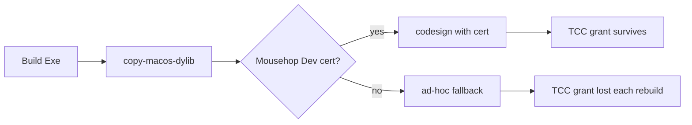

# Stable macOS Dev Signing (TCC Survives Rebuilds)

## Problem

[`scripts/copy-macos-dylib.sh`](scripts/copy-macos-dylib.sh) ends with:

```sh
codesign --force --deep --sign - "$bundle_path"
```

Ad-hoc signatures produce a designated requirement of `cdhash H"…"`. That hash changes every rebuild, so TCC treats `MousehopDev.app` as a new binary even though the path and bundle ID (`com.mousehop.Mousehop`) stay the same. Grants look enabled in System Settings but `AXIsProcessTrusted()` returns false until you re-toggle.

[`scripts/build-macos-release.sh`](scripts/build-macos-release.sh) (the **Build Exe** task) then does `rm -rf MousehopDev.app && cp -R …`, which also replaces the bundle each time.

## Fix

Sign local builds with a **stable self-signed Code Signing certificate** so the designated requirement becomes `identifier "com.mousehop.Mousehop" and certificate leaf = H"…"`. Rebuilds keep the same leaf hash → TCC grants stick.



## Implementation

### 1. One-time cert script: [`scripts/create-macos-dev-cert.sh`](scripts/create-macos-dev-cert.sh)

- Idempotent: if identity `"Mousehop Dev"` already exists in the login keychain, exit 0.
- Generate a self-signed Code Signing cert via openssl, export PKCS#12 with `-legacy` (OpenSSL 3 compatibility), import with `security import … -A -T /usr/bin/codesign`.
- No sudo; not for distribution / notarization.
- Optional `KEYCHAIN_PASSWORD` to suppress the first codesign key-access prompt (same pattern as other open-source projects).

### 2. Prefer that identity when signing: [`scripts/copy-macos-dylib.sh`](scripts/copy-macos-dylib.sh)

Replace the hard-coded ad-hoc sign with:

- If `security find-identity -p codesigning` finds `"Mousehop Dev"`, sign with that name.
- Else fall back to `codesign --force --deep --sign -` (CI / machines without the cert).
- Do **not** add `--options runtime` for this local path (hardened runtime without entitlements can silently block Accessibility).

### 3. Wire into Build Exe: [`scripts/build-macos-release.sh`](scripts/build-macos-release.sh)

- Call `scripts/create-macos-dev-cert.sh` before vendoring/signing so the first Build Exe creates the cert automatically.
- Replace `rm -rf` + `cp -R` for `MousehopDev.app` with in-place sync (`rsync -a --delete` into an existing bundle, or create once then sync) so the launch path stays stable.

### 4. Docs: brief note in [`README.md`](README.md) macOS build section

- Explain why the cert exists, that Build Exe creates it once, and that **one** Accessibility re-grant is needed after switching off ad-hoc (old grants are pinned to the old cdhash).
- How to verify: `codesign -d -r- MousehopDev.app` should show `certificate leaf = H"…"`, not `cdhash`.

## Out of scope

- CI / notarized Developer ID signing ([`scripts/sign-and-notarize.sh`](scripts/sign-and-notarize.sh)) stays as-is.
- No Apple Developer account required.

## After merge (manual once)

1. Run Build Exe (creates cert + signs with it).
2. Re-enable Mousehop under System Settings → Privacy & Security → Accessibility (one last time).
3. Subsequent Build Exe runs should keep the grant.